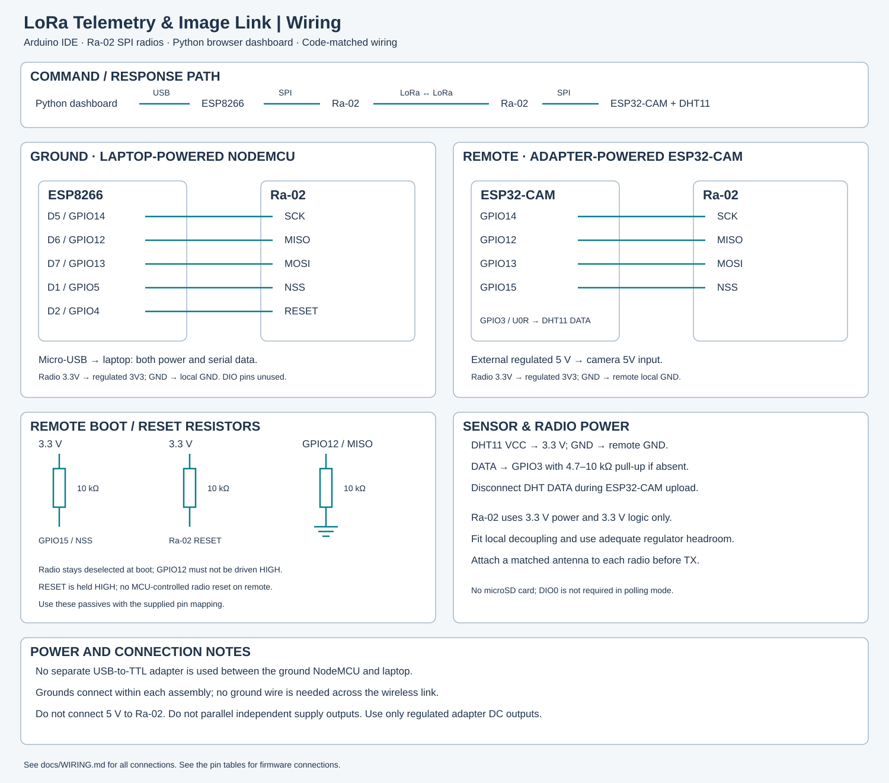

# LoRa Telemetry & Image Link

**A command-driven telemetry and JPEG transfer system using ESP32-CAM, ESP8266 and two Ra-02 radios.**

A Python browser dashboard sends a request over USB serial to the ground ESP8266. The ground node converts it into a radio packet. The remote ESP32-CAM reads a DHT11 or captures an image, then returns the requested data over LoRa. The ground node verifies packets, reconstructs the image and forwards the result to the dashboard.

The remote node represents a rover communication subsystem; this project focuses on the communication link rather than a moving platform. Built by Ibrahim Mallick in collaboration with a friend.



## Features

- On-demand temperature and humidity readings.
- On-demand ESP32-CAM JPEG capture and packetization.
- An entire image burst followed by a receiver acknowledgement/missing-packet report.
- Selective retransmission of absent packets, with bounded repair rounds.
- Packet CRC16 plus whole-image CRC32 verification.
- Transaction IDs, sequence numbers, duplicate suppression and timeouts.
- Local Python/Flask browser dashboard with sensor graphs, packet progress, RSSI and reconstructed image download.
- Arduino IDE sketch folders for both boards.
- No Wi-Fi, Telegram, cloud account or separate ground-side USB-to-TTL adapter required.

## System

| Remote node | Radio link | Ground station |
| --- | --- | --- |
| AI-Thinker ESP32-CAM + DHT11 | Two Ra-02 modules over LoRa | ESP8266 NodeMCU |
| External regulated camera supply | Commands, responses and ACK reports | Micro-USB to laptop for power and serial data |

The Python application runs on the laptop; its webpage opens at `http://127.0.0.1:5000`. The Ra-02 connects to each MCU using SPI, not UART. The radio packet protocol is custom point-to-point LoRa, not LoRaWAN.

## Quick start

1. Read [wiring](docs/WIRING.md), attach both antennas, and connect the boards.
2. Follow [Arduino IDE setup](docs/SETUP.md) to install the board packages and libraries.
3. Upload `firmware/RemoteNode/RemoteNode.ino` to the ESP32-CAM and `firmware/GroundStation/GroundStation.ino` to the ESP8266.
4. Keep both boards' radio settings matched and follow the supplied pin mapping.
5. Install Python 3.10+ and open a terminal in `dashboard/`:

```sh
python -m venv .venv
```

Activate it on Windows:

```powershell
.venv\Scripts\Activate.ps1
```

Or macOS/Linux:

```sh
source .venv/bin/activate
```

Then:

```sh
python -m pip install -r requirements.txt
python app.py
```

6. Open `http://127.0.0.1:5000`, select the ESP8266's serial port and click **Connect**. Close Arduino Serial Monitor first.
7. Select **Send value** or **Send picture**. Only one transfer runs at a time.

Full instructions: [SETUP.md](docs/SETUP.md).

## Image delivery

1. Ground sends a `TAKE_PHOTO` command with a transaction ID.
2. Remote captures JPEG and announces image size, chunk size, packet count and image CRC32.
3. Remote sends all numbered chunks without waiting for individual ACKs.
4. An END packet marks the receiver-feedback window.
5. Ground returns a missing-packet bitmap. Remote selectively resends missing chunks, then END again.
6. A complete image with a matching CRC32 receives a success ACK and is sent over USB serial to Python.
7. Python independently checks the decoded image length and CRC32 before displaying it.

Lost END/ACK packets cause END to be repeated. Duplicate image packets do not increase the unique received count. A missing metadata packet can be requested again. Sensor readings use a separate short ACK/retry exchange.

See [PROTOCOL.md](docs/PROTOCOL.md) for the byte layout and recovery rules.

## Configuration

| Setting | Default |
| --- | --- |
| Radio frequency | 433 MHz; confirm matching module/antenna and locally permitted use |
| Bandwidth / spreading factor | 125 kHz / SF8 |
| Coding rate / TX power | 4/5 / 10 dBm |
| Packet data chunk | 160 bytes |
| Maximum JPEG | 24 KiB, to bound ESP8266 memory use |
| Camera | QVGA 320×240 JPEG, quality setting 16 |
| USB serial | 115200 baud |
| ACK wait / image repair rounds | 3.5 seconds / up to five repair rounds |

Both sketches have `RadioConfig.h`. Change shared radio values on **both nodes**. The shared `Protocol.h` and `RadioLink.h` copies must remain identical.

Typical observed image-transfer time in the project was approximately **40–90 seconds**. Transfer duration depends on JPEG size, radio settings, packet gaps and loss.

## Repository contents

| Folder/file | Contents |
| --- | --- |
| `firmware/RemoteNode/` | ESP32-CAM sketch, radio config and protocol |
| `firmware/GroundStation/` | ESP8266 USB/LoRa bridge and image assembler |
| `dashboard/` | Python backend, browser UI and dependency list |
| `docs/WIRING.md`, `docs/wiring.svg` | Circuit connections, power and editable diagram |
| `docs/PROTOCOL.md` | Packet format and acknowledgements |
| `docs/SETUP.md` | Arduino IDE and Python walkthrough |
| `docs/PUBLISH.md` | Extract-and-upload GitHub instructions |
| `docs/TESTING.md` | Checks and integration procedure |
| `tests/` | Native C++ protocol and Python dashboard checks |

## Usage notes

Use regulated **3.3 V power and logic for Ra-02**; do not connect it to 5 V. Attach the correct antenna before transmitting. Use radio frequency, output power and pacing permitted in your location; configurable defaults do not establish permission.

This is a low-data-rate image/telemetry prototype, not video streaming. The radio link provides error detection, not encryption or sender authentication. The dashboard runs locally on the laptop and is separate from a public portfolio website.

## Credits

Project: **Ibrahim Mallick**, built collaboratively. Add the collaborator’s preferred credit and roles here.

Dependencies include Arduino LoRa by Sandeep Mistry, Adafruit DHT Sensor Library, Adafruit Unified Sensor, Flask and pySerial. Their respective licenses apply. Select a project license after confirming contributor preferences.
